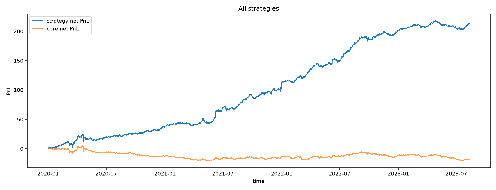

# Large-Scale Strategy Selection with a Two-Layer Synthetic Option Filter

This project builds a reproducible research pipeline for generating, screening, calibrating, and evaluating a large collection of systematic futures strategies. The central idea is to treat the cumulative PnL path of a base strategy as a synthetic underlying and apply two consecutive nonlinear, option-like filters to identify persistent trend, breakout, and mean-reversion regimes.

The filters are **not exchange-traded options**. They do not use market option premiums, implied volatility, time value, interest rates, or an option-pricing model. The call/put terminology describes the direction and bounds of a synthetic delta transformation.



## Project objective

The research asks whether a broad strategy universe can be reduced to a more robust portfolio through a staged process:

1. audit the market data and available contract history;
2. generate heterogeneous base strategies;
3. transform each base PnL path with two nonlinear filters;
4. calibrate only on earlier observations;
5. retain profitable stand-alone strategies as well as improved filtered strategies;
6. evaluate the final selection on a held-out period;
7. test whether a universal protective overlay improves the portfolio.

## Data

The original dataset is a 1.46 GB pickle containing 35 five-minute futures tables and 21,169,205 rows. Each table follows the same schema: timestamp, contract symbol, OHLC prices, volume, open interest, and sale condition. Coverage varies by market from 2008 to August 2023.

The audit found 3,341 unique contract codes and retained 28 of the 35 markets for the initial research pass. The source contains sequential active contracts rather than simultaneous snapshots of a full futures curve, so conventional calendar-spread research is outside the scope of this dataset. Raw market data are not included in the repository.

## Methods

- 1,636 base strategies across momentum, reversal, moving-average, breakout, pair, and sector constructions.
- A bounded hyperbolic-tangent synthetic delta for call-like and put-like layers.
- One-bar lag between the signal and position to prevent look-ahead bias.
- Initial screening, coarse calibration, local fine tuning, and a final held-out evaluation.
- Group-level ranking and rescue rules for selected mean-reversion candidates.
- Portfolio aggregation, drawdown analysis, risk/return diagnostics, and return-on-capital scenarios.
- A separate protective put-overlay experiment evaluated after the main selection pipeline.

The main implementation is split into numbered Python scripts and matching notebooks in [`main/02_pipeline`](main/02_pipeline). Saved run manifests, tables, and figures make it possible to audit the completed experiment without rerunning the 21-million-row pipeline.

## Confirmed results

| Stage | Confirmed scale |
|---|---:|
| Base strategy factory | 1,636 strategies |
| Initial two-layer sweep | 13,088 configurations |
| Coarse calibration | 109,688 configurations |
| Fine tuning | 181,776 configurations |
| Protective overlay training | 61,632 configurations |
| Final held-out run | 664 strategies, 0 execution errors |

The final 664-strategy portfolio produced the following historical metrics in model units:

| Metric | Result |
|---|---:|
| Cumulative result | 213.9096 |
| Maximum drawdown | -15.4437 |
| Sharpe ratio | 3.1364 |
| Sortino ratio | 4.0972 |
| Profit factor | 1.1135 |

The 236 filtered strategies formed a lower-drawdown subportfolio with a cumulative result of 64.0674, maximum drawdown of -1.7454, Sharpe ratio of 5.3319, and Sortino ratio of 7.5453.

The universal protective overlay was rejected. It reduced the cumulative result from 213.9096 to 205.2367 while changing maximum drawdown only from -15.4437 to -15.4095. Preserving this negative result is an important part of the research record.

## Repository structure

```text
main/
  01_data_audit/       data-quality notebooks and compact audit outputs
  02_pipeline/         numbered Python scripts, notebooks, and protocol config
  03_run_manifests/    metadata from completed pipeline stages
  04_results/          leaderboards and portfolio summary tables
  05_figures/          report-ready charts
```

## Reproduction

```bash
python -m pip install -r requirements.txt
```

Place the market dataset at `data/dfs_5min.pickle`, or update the path constants in the pipeline. Run stages `01` through `09` in order, then run stages `11` and `12` for the overlay experiment and stage `13` for report charts. Stage `10` is a cleanup utility and should only be used after reviewing its target paths.

## Limitations

- Results are historical research outputs, not live-trading performance.
- The source does not provide a simultaneous multi-expiry futures curve.
- Full walk-forward validation, multiple-testing corrections, bootstrap stability, and market-impact modeling remain future work.
- The current execution model does not reconstruct order-book queues or partial fills.

This repository is intended as a quantitative research portfolio project, not as investment advice or a production trading system.
